  
  
  
  
  
  

<table>
<tr>
<td width="320" align="center" valign="middle"></td>
<td valign="middle">

<ul>
<li>🛠️ Backend/Go engineer building toward cloud-native systems, active contributor to CNCF-adjacent projects</li>
<li>☁️ Working with AWS, containers, and CI/CD; sharpening DevOps fundamentals</li>
<li>🌍 Send patches and bug reports into other people's repos, not just my own — see contributions below</li>
<li>📫 Reach me at <a href="mailto:rjss2829singh@gmail.com">rjss2829singh@gmail.com</a> · 🌐 <a href="https://portfolio-eight-psi-dl8k390tdd.vercel.app/">Portfolio</a></li>
</ul>
</td>
</tr>
</table>

## 🌍 Open Source Contributions

| Repo | Type | Contribution | Status |
|---|---|---|---|
| [openkruise/agents](https://github.com/openkruise/agents/issues/941) | Issue | Filed security bug: credential-bearing request headers logged in proxy `ext_proc` | Open |
| [DevanshuTripathi/vodka](https://github.com/DevanshuTripathi/vodka/pull/84) | PR | Fixed CORS: explicitly handle OPTIONS preflight requests in `ServeHTTP` | Merged |
| [agnivo988/Repo-lyzer](https://github.com/agnivo988/Repo-lyzer/pull/356) | PR | Added retry/backoff and rate-limit handling for GitHub API calls | Merged |
| [Rtarun3606k/TakaTime](https://github.com/Rtarun3606k/TakaTime/pull/59) | PR | Fixed wrong error variable checked after SQLite init in the upload command | Merged |
| [Anand-240/hyperdraft](https://github.com/Anand-240/hyperdraft/pull/1) | PR | Enhanced auth screen, landing page, and session navigation | Merged |
| [AnkanMisra/MicroAI-Paygate](https://github.com/AnkanMisra/MicroAI-Paygate/pull/194) | PR | Added a deterministic mock AI provider for local/demo use | Open |
| [sahoo-tech/Execra](https://github.com/sahoo-tech/Execra/issues/264) | Issue | Reported LSP violation (non-string return) and a duplicate router registration bug | Open |

## 🛠️ Tech Stack

  <b>Cloud, DevOps &amp; Infrastructure</b> 
   

  <b>Languages</b> 
  

  <b>Full-Stack Development</b> 
  

  <b>Databases &amp; Tools</b> 
  

## 📌 Featured Projects

| Project | Description | Tech |
|---|---|---|
| [**Go-Auth**](https://github.com/rajsingh1301/Go-Auth) | Backend auth API — signup, login, and JWT-based session validation |   |
| [**CortexOps**](https://github.com/rajsingh1301/CortexOps) | Ops agent for CockroachDB that watches cluster telemetry, flags anomalies, proposes remediations for human approval, and logs decision history via vector search |    |
| [**FileDock**](https://github.com/rajsingh1301/FileDock) | Cloud file storage & sharing platform with OTP auth and drag-and-drop uploads |   |

## 🤝 Connect with Me

  
  
  
  
  

<!-- Proudly created with GPRM ( https://gprm.itsvg.in ) -->
